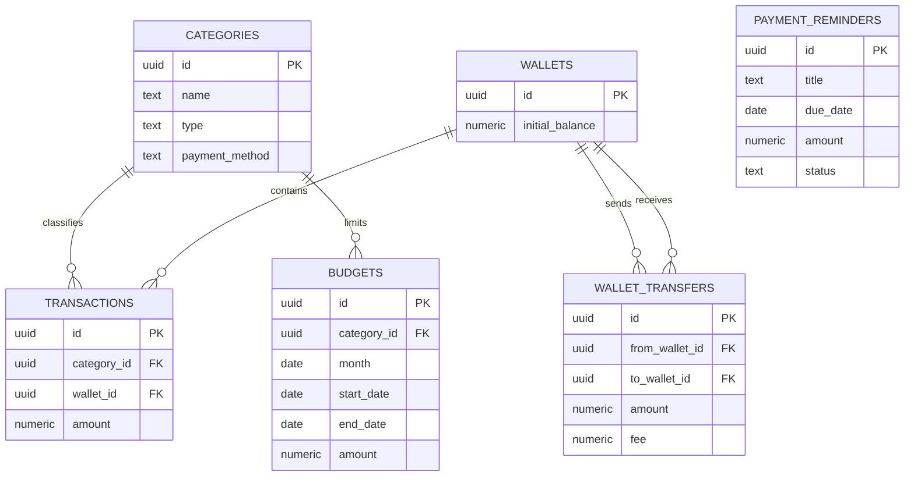

# Database

Database menggunakan PostgreSQL yang dikelola oleh Supabase. Semua nilai uang
disimpan sebagai `numeric(18,2)`, bukan floating point.

## Relasi Antar Tabel



## Tabel

### `categories`

Menyimpan kategori transaksi. `type` bernilai `income` atau `expense`, sedangkan
`payment_method` bernilai `cash` atau `non_cash`. Kombinasi nama, tipe, dan
metode pembayaran harus unik sehingga nama kategori yang sama dapat tersedia
untuk Cash dan Non-Cash.

### `wallets`

Menyimpan rekening, uang tunai, e-wallet, atau sumber dana lain.
`initial_balance` adalah titik awal perhitungan saldo.

### `transactions`

Menyimpan pemasukan dan pengeluaran. Kategori dan wallet memakai
`ON DELETE RESTRICT` agar riwayat tidak kehilangan referensi. Kolom
`attachment_*` menyimpan metadata file; binary file berada pada bucket Storage
privat `transaction-attachments`.

### `budgets`

Menyimpan batas pengeluaran per kategori pada rentang tanggal bebas. Kolom
`month` masih disimpan sebagai legacy untuk kompatibilitas backup lama, tetapi
perhitungan memakai `start_date` dan `end_date`.

### `wallet_transfers`

Menyimpan perpindahan dana antar wallet. Transfer bukan transaksi income atau
expense. Wallet asal dan tujuan harus berbeda.

### `payment_reminders`

Menyimpan jadwal pembayaran yang berdiri sendiri dari transaksi. `status`
bernilai `pending` atau `paid`. `paid_at` wajib terisi hanya ketika status
`paid`. Nominal bersifat opsional sehingga reminder juga dapat digunakan untuk
tagihan yang jumlahnya belum diketahui.

## Perhitungan Saldo Wallet

Saldo tidak disimpan sebagai kolom mutable. API menghitung saldo:

```text
balance =
  initial_balance
  + total income
  - total expense
  + total transfer masuk
  - total transfer keluar
  - biaya transfer keluar
```

Pendekatan ini menghindari ketidaksinkronan saldo ketika transaksi diedit atau
dihapus. Untuk volume data besar, perhitungan dapat dipindahkan ke SQL view,
materialized view, atau ledger.

## Budget dan Transaksi

Nilai `spent` dihitung dari transaksi `expense` dengan:

- `transaction_date` berada di antara `budgets.start_date` dan
  `budgets.end_date`.
- Nama kategori transaksi sama dengan nama kategori budget.
- Cash dan Non-Cash tidak dipisah karena budget menghitung akumulasi kategori.

Transfer antar wallet tidak mengurangi budget karena bukan pengeluaran
konsumtif.

## SQL Schema Lengkap

File kanonis berada di `supabase/schema.sql`. Schema lengkap:

```sql
create extension if not exists "pgcrypto";

create table if not exists public.categories (
  id uuid primary key default gen_random_uuid(),
  name text not null check (char_length(name) between 1 and 80),
  type text not null check (type in ('income', 'expense')),
  payment_method text not null default 'non_cash'
    check (payment_method in ('cash', 'non_cash')),
  color text not null default '#70e1b0',
  icon text,
  created_at timestamptz not null default now(),
  updated_at timestamptz not null default now(),
  unique (name, type, payment_method)
);

create table if not exists public.wallets (
  id uuid primary key default gen_random_uuid(),
  name text not null unique check (char_length(name) between 1 and 80),
  type text not null,
  initial_balance numeric(18,2) not null default 0 check (initial_balance >= 0),
  color text not null default '#70e1b0',
  created_at timestamptz not null default now(),
  updated_at timestamptz not null default now()
);

create table if not exists public.transactions (
  id uuid primary key default gen_random_uuid(),
  type text not null check (type in ('income', 'expense')),
  amount numeric(18,2) not null check (amount > 0),
  description text not null check (char_length(description) between 1 and 180),
  transaction_date date not null default current_date,
  notes text,
  attachment_path text,
  attachment_name text,
  attachment_type text check (
    attachment_type is null or attachment_type in (
      'image/jpeg', 'image/png', 'image/webp', 'application/pdf'
    )
  ),
  attachment_size bigint check (
    attachment_size is null or attachment_size between 1 and 10485760
  ),
  category_id uuid not null references public.categories(id) on delete restrict,
  wallet_id uuid not null references public.wallets(id) on delete restrict,
  created_at timestamptz not null default now(),
  updated_at timestamptz not null default now()
);

insert into storage.buckets (
  id, name, public, file_size_limit, allowed_mime_types
)
values (
  'transaction-attachments',
  'transaction-attachments',
  false,
  10485760,
  array['image/jpeg', 'image/png', 'image/webp', 'application/pdf']
)
on conflict (id) do update set
  public = excluded.public,
  file_size_limit = excluded.file_size_limit,
  allowed_mime_types = excluded.allowed_mime_types;

create table if not exists public.budgets (
  id uuid primary key default gen_random_uuid(),
  category_id uuid not null references public.categories(id) on delete cascade,
  month date not null default date_trunc('month', current_date)::date
    check (date_trunc('month', month)::date = month),
  start_date date not null default current_date,
  end_date date not null default current_date,
  amount numeric(18,2) not null check (amount > 0),
  created_at timestamptz not null default now(),
  updated_at timestamptz not null default now(),
  check (start_date <= end_date),
  unique (category_id, start_date, end_date)
);

create table if not exists public.wallet_transfers (
  id uuid primary key default gen_random_uuid(),
  from_wallet_id uuid not null references public.wallets(id) on delete restrict,
  to_wallet_id uuid not null references public.wallets(id) on delete restrict,
  amount numeric(18,2) not null check (amount > 0),
  fee numeric(18,2) not null default 0 check (fee >= 0),
  transfer_date date not null default current_date,
  notes text,
  created_at timestamptz not null default now(),
  updated_at timestamptz not null default now(),
  check (from_wallet_id <> to_wallet_id)
);

create table if not exists public.payment_reminders (
  id uuid primary key default gen_random_uuid(),
  title text not null check (char_length(title) between 1 and 120),
  due_date date not null,
  amount numeric(18,2) check (amount is null or amount > 0),
  notes text,
  status text not null default 'pending'
    check (status in ('pending', 'paid')),
  paid_at timestamptz,
  created_at timestamptz not null default now(),
  updated_at timestamptz not null default now(),
  check (
    (status = 'pending' and paid_at is null) or
    (status = 'paid' and paid_at is not null)
  )
);

create index if not exists transactions_date_idx
  on public.transactions (transaction_date desc);
create index if not exists transactions_wallet_idx
  on public.transactions (wallet_id);
create index if not exists transactions_category_idx
  on public.transactions (category_id);
create index if not exists budgets_month_idx
  on public.budgets (month);
create index if not exists budgets_date_range_idx
  on public.budgets (start_date, end_date);
create index if not exists wallet_transfers_date_idx
  on public.wallet_transfers (transfer_date desc);
create index if not exists payment_reminders_status_due_date_idx
  on public.payment_reminders (status, due_date);

create or replace function public.set_updated_at()
returns trigger
language plpgsql
as $$
begin
  new.updated_at = now();
  return new;
end;
$$;

drop trigger if exists categories_set_updated_at on public.categories;
create trigger categories_set_updated_at
before update on public.categories
for each row execute function public.set_updated_at();

drop trigger if exists wallets_set_updated_at on public.wallets;
create trigger wallets_set_updated_at
before update on public.wallets
for each row execute function public.set_updated_at();

drop trigger if exists transactions_set_updated_at on public.transactions;
create trigger transactions_set_updated_at
before update on public.transactions
for each row execute function public.set_updated_at();

drop trigger if exists budgets_set_updated_at on public.budgets;
create trigger budgets_set_updated_at
before update on public.budgets
for each row execute function public.set_updated_at();

drop trigger if exists wallet_transfers_set_updated_at on public.wallet_transfers;
create trigger wallet_transfers_set_updated_at
before update on public.wallet_transfers
for each row execute function public.set_updated_at();

drop trigger if exists payment_reminders_set_updated_at on public.payment_reminders;
create trigger payment_reminders_set_updated_at
before update on public.payment_reminders
for each row execute function public.set_updated_at();

alter table public.categories enable row level security;
alter table public.wallets enable row level security;
alter table public.transactions enable row level security;
alter table public.budgets enable row level security;
alter table public.wallet_transfers enable row level security;
alter table public.payment_reminders enable row level security;

create or replace function public.restore_finance_backup(payload jsonb)
returns void
language plpgsql
security definer
set search_path = public
as $$
begin
  if coalesce((payload ->> 'version')::int, 0) <> 1 then
    raise exception 'Versi backup tidak didukung';
  end if;

  delete from payment_reminders;
  delete from wallet_transfers;
  delete from budgets;
  delete from transactions;
  delete from wallets;
  delete from categories;

  insert into categories (
    id, name, type, payment_method, color, icon, created_at, updated_at
  )
  select id, name, type, coalesce(payment_method, 'non_cash'),
    color, icon, created_at, updated_at
  from jsonb_to_recordset(payload #> '{data,categories}')
    as x(
      id uuid, name text, type text, payment_method text, color text, icon text,
      created_at timestamptz, updated_at timestamptz
    );

  insert into wallets (
    id, name, type, initial_balance, color, created_at, updated_at
  )
  select id, name, type, initial_balance, color, created_at, updated_at
  from jsonb_to_recordset(payload #> '{data,wallets}')
    as x(
      id uuid, name text, type text, initial_balance numeric, color text,
      created_at timestamptz, updated_at timestamptz
    );

  insert into transactions (
    id, type, amount, description, transaction_date, notes, attachment_path,
    attachment_name, attachment_type, attachment_size,
    category_id, wallet_id, created_at, updated_at
  )
  select id, type, amount, description, transaction_date, notes,
    attachment_path, attachment_name, attachment_type, attachment_size,
    category_id, wallet_id, created_at, updated_at
  from jsonb_to_recordset(payload #> '{data,transactions}')
    as x(
      id uuid, type text, amount numeric, description text,
      transaction_date date, notes text, attachment_path text,
      attachment_name text, attachment_type text, attachment_size bigint,
      category_id uuid, wallet_id uuid, created_at timestamptz,
      updated_at timestamptz
    );

  insert into budgets (
    id, category_id, month, start_date, end_date, amount, created_at, updated_at
  )
  select id, category_id,
    coalesce(month, date_trunc('month', coalesce(start_date, current_date))::date),
    coalesce(start_date, month, current_date),
    coalesce(
      end_date,
      (date_trunc('month', coalesce(month, start_date, current_date)) +
        interval '1 month - 1 day')::date
    ),
    amount, created_at, updated_at
  from jsonb_to_recordset(payload #> '{data,budgets}')
    as x(
      id uuid, category_id uuid, month date, start_date date, end_date date,
      amount numeric, created_at timestamptz, updated_at timestamptz
    );

  insert into wallet_transfers (
    id, from_wallet_id, to_wallet_id, amount, fee, transfer_date,
    notes, created_at, updated_at
  )
  select id, from_wallet_id, to_wallet_id, amount, fee, transfer_date,
    notes, created_at, updated_at
  from jsonb_to_recordset(payload #> '{data,wallet_transfers}')
    as x(
      id uuid, from_wallet_id uuid, to_wallet_id uuid, amount numeric,
      fee numeric, transfer_date date, notes text,
      created_at timestamptz, updated_at timestamptz
    );

  insert into payment_reminders (
    id, title, due_date, amount, notes, status, paid_at, created_at, updated_at
  )
  select id, title, due_date, amount, notes, status, paid_at,
    created_at, updated_at
  from jsonb_to_recordset(
    coalesce(payload #> '{data,payment_reminders}', '[]'::jsonb)
  )
    as x(
      id uuid, title text, due_date date, amount numeric, notes text,
      status text, paid_at timestamptz, created_at timestamptz,
      updated_at timestamptz
    );
end;
$$;

revoke all on function public.restore_finance_backup(jsonb) from public;
revoke all on function public.restore_finance_backup(jsonb) from anon;
revoke all on function public.restore_finance_backup(jsonb) from authenticated;
grant execute on function public.restore_finance_backup(jsonb) to service_role;
```

## RLS

RLS aktif, tetapi schema tidak membuat policy untuk `anon` atau
`authenticated`. Akibatnya, request langsung dari browser ditolak. API server
menggunakan service role setelah memverifikasi session PIN.

## Restore

Fungsi restore memakai `SECURITY DEFINER`, mengunci `search_path`, dan hanya
dapat dijalankan oleh role `service_role`. Seluruh perintah berada dalam satu
transaksi function call.

## Perubahan Schema

Jika schema berubah:

1. Ubah `supabase/schema.sql`.
2. Buat migration terpisah untuk database production.
3. Perbarui `types/database.ts`.
4. Perbarui validasi Zod.
5. Perbarui backup version jika format tidak backward-compatible.
6. Jalankan typecheck, lint, dan build.

Migration penambahan klasifikasi pembayaran tersedia di
`supabase/migrations/20260607_add_category_payment_method.sql`. Kategori lama
diberi default `non_cash`, dan fungsi restore tetap menerima backup versi lama
yang belum memiliki field `payment_method`.

Migration lampiran tersedia di
`supabase/migrations/20260607_add_transaction_attachments.sql`. Bucket dibuat
private, dibatasi 10 MB, dan hanya menerima JPEG, PNG, WebP, atau PDF.
