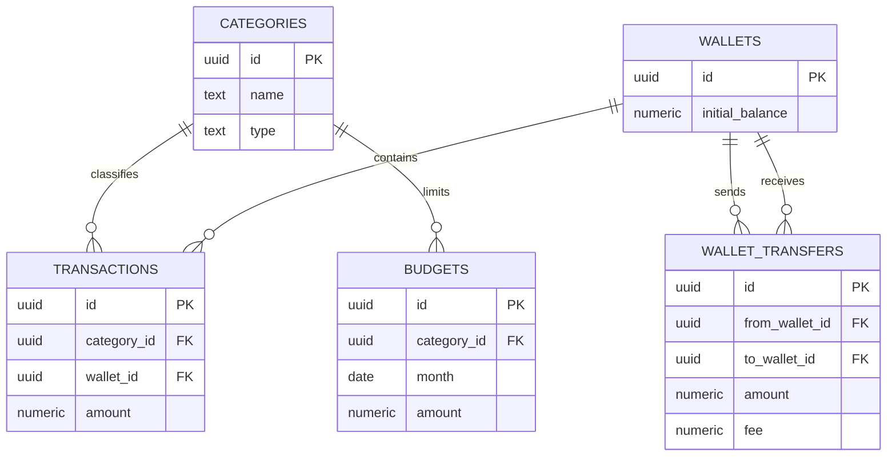

# Database

Database menggunakan PostgreSQL yang dikelola oleh Supabase. Semua nilai uang
disimpan sebagai `numeric(18,2)`, bukan floating point.

## Relasi Antar Tabel



## Tabel

### `categories`

Menyimpan kategori transaksi. `type` bernilai `income` atau `expense`.
Kombinasi nama dan tipe harus unik.

### `wallets`

Menyimpan rekening, uang tunai, e-wallet, atau sumber dana lain.
`initial_balance` adalah titik awal perhitungan saldo.

### `transactions`

Menyimpan pemasukan dan pengeluaran. Kategori dan wallet memakai
`ON DELETE RESTRICT` agar riwayat tidak kehilangan referensi.

### `budgets`

Menyimpan batas bulanan per kategori. `month` selalu tanggal pertama bulan dan
kombinasi kategori-bulan unik.

### `wallet_transfers`

Menyimpan perpindahan dana antar wallet. Transfer bukan transaksi income atau
expense. Wallet asal dan tujuan harus berbeda.

## Perhitungan Saldo Wallet

Saldo tidak disimpan sebagai kolom mutable. API menghitung saldo:

```text
balance =
  initial_balance
  + total income
  - total expense
  + total transfer masuk
  - total transfer keluar
  - biaya transfer keluar
```

Pendekatan ini menghindari ketidaksinkronan saldo ketika transaksi diedit atau
dihapus. Untuk volume data besar, perhitungan dapat dipindahkan ke SQL view,
materialized view, atau ledger.

## Budget dan Transaksi

Nilai `spent` dihitung dari transaksi `expense` dengan:

- `category_id` yang sama.
- Bulan `transaction_date` yang sama dengan `budgets.month`.

Transfer antar wallet tidak mengurangi budget karena bukan pengeluaran
konsumtif.

## SQL Schema Lengkap

File kanonis berada di `supabase/schema.sql`. Schema lengkap:

```sql
create extension if not exists "pgcrypto";

create table if not exists public.categories (
  id uuid primary key default gen_random_uuid(),
  name text not null check (char_length(name) between 1 and 80),
  type text not null check (type in ('income', 'expense')),
  color text not null default '#70e1b0',
  icon text,
  created_at timestamptz not null default now(),
  updated_at timestamptz not null default now(),
  unique (name, type)
);

create table if not exists public.wallets (
  id uuid primary key default gen_random_uuid(),
  name text not null unique check (char_length(name) between 1 and 80),
  type text not null,
  initial_balance numeric(18,2) not null default 0 check (initial_balance >= 0),
  color text not null default '#70e1b0',
  created_at timestamptz not null default now(),
  updated_at timestamptz not null default now()
);

create table if not exists public.transactions (
  id uuid primary key default gen_random_uuid(),
  type text not null check (type in ('income', 'expense')),
  amount numeric(18,2) not null check (amount > 0),
  description text not null check (char_length(description) between 1 and 180),
  transaction_date date not null default current_date,
  notes text,
  category_id uuid not null references public.categories(id) on delete restrict,
  wallet_id uuid not null references public.wallets(id) on delete restrict,
  created_at timestamptz not null default now(),
  updated_at timestamptz not null default now()
);

create table if not exists public.budgets (
  id uuid primary key default gen_random_uuid(),
  category_id uuid not null references public.categories(id) on delete cascade,
  month date not null check (date_trunc('month', month)::date = month),
  amount numeric(18,2) not null check (amount > 0),
  created_at timestamptz not null default now(),
  updated_at timestamptz not null default now(),
  unique (category_id, month)
);

create table if not exists public.wallet_transfers (
  id uuid primary key default gen_random_uuid(),
  from_wallet_id uuid not null references public.wallets(id) on delete restrict,
  to_wallet_id uuid not null references public.wallets(id) on delete restrict,
  amount numeric(18,2) not null check (amount > 0),
  fee numeric(18,2) not null default 0 check (fee >= 0),
  transfer_date date not null default current_date,
  notes text,
  created_at timestamptz not null default now(),
  updated_at timestamptz not null default now(),
  check (from_wallet_id <> to_wallet_id)
);

create index if not exists transactions_date_idx
  on public.transactions (transaction_date desc);
create index if not exists transactions_wallet_idx
  on public.transactions (wallet_id);
create index if not exists transactions_category_idx
  on public.transactions (category_id);
create index if not exists budgets_month_idx
  on public.budgets (month);
create index if not exists wallet_transfers_date_idx
  on public.wallet_transfers (transfer_date desc);

create or replace function public.set_updated_at()
returns trigger
language plpgsql
as $$
begin
  new.updated_at = now();
  return new;
end;
$$;

drop trigger if exists categories_set_updated_at on public.categories;
create trigger categories_set_updated_at
before update on public.categories
for each row execute function public.set_updated_at();

drop trigger if exists wallets_set_updated_at on public.wallets;
create trigger wallets_set_updated_at
before update on public.wallets
for each row execute function public.set_updated_at();

drop trigger if exists transactions_set_updated_at on public.transactions;
create trigger transactions_set_updated_at
before update on public.transactions
for each row execute function public.set_updated_at();

drop trigger if exists budgets_set_updated_at on public.budgets;
create trigger budgets_set_updated_at
before update on public.budgets
for each row execute function public.set_updated_at();

drop trigger if exists wallet_transfers_set_updated_at on public.wallet_transfers;
create trigger wallet_transfers_set_updated_at
before update on public.wallet_transfers
for each row execute function public.set_updated_at();

alter table public.categories enable row level security;
alter table public.wallets enable row level security;
alter table public.transactions enable row level security;
alter table public.budgets enable row level security;
alter table public.wallet_transfers enable row level security;

create or replace function public.restore_finance_backup(payload jsonb)
returns void
language plpgsql
security definer
set search_path = public
as $$
begin
  if coalesce((payload ->> 'version')::int, 0) <> 1 then
    raise exception 'Versi backup tidak didukung';
  end if;

  delete from wallet_transfers;
  delete from budgets;
  delete from transactions;
  delete from wallets;
  delete from categories;

  insert into categories (id, name, type, color, icon, created_at, updated_at)
  select id, name, type, color, icon, created_at, updated_at
  from jsonb_to_recordset(payload #> '{data,categories}')
    as x(
      id uuid, name text, type text, color text, icon text,
      created_at timestamptz, updated_at timestamptz
    );

  insert into wallets (
    id, name, type, initial_balance, color, created_at, updated_at
  )
  select id, name, type, initial_balance, color, created_at, updated_at
  from jsonb_to_recordset(payload #> '{data,wallets}')
    as x(
      id uuid, name text, type text, initial_balance numeric, color text,
      created_at timestamptz, updated_at timestamptz
    );

  insert into transactions (
    id, type, amount, description, transaction_date, notes,
    category_id, wallet_id, created_at, updated_at
  )
  select id, type, amount, description, transaction_date, notes,
    category_id, wallet_id, created_at, updated_at
  from jsonb_to_recordset(payload #> '{data,transactions}')
    as x(
      id uuid, type text, amount numeric, description text,
      transaction_date date, notes text, category_id uuid, wallet_id uuid,
      created_at timestamptz, updated_at timestamptz
    );

  insert into budgets (
    id, category_id, month, amount, created_at, updated_at
  )
  select id, category_id, month, amount, created_at, updated_at
  from jsonb_to_recordset(payload #> '{data,budgets}')
    as x(
      id uuid, category_id uuid, month date, amount numeric,
      created_at timestamptz, updated_at timestamptz
    );

  insert into wallet_transfers (
    id, from_wallet_id, to_wallet_id, amount, fee, transfer_date,
    notes, created_at, updated_at
  )
  select id, from_wallet_id, to_wallet_id, amount, fee, transfer_date,
    notes, created_at, updated_at
  from jsonb_to_recordset(payload #> '{data,wallet_transfers}')
    as x(
      id uuid, from_wallet_id uuid, to_wallet_id uuid, amount numeric,
      fee numeric, transfer_date date, notes text,
      created_at timestamptz, updated_at timestamptz
    );
end;
$$;

revoke all on function public.restore_finance_backup(jsonb) from public;
revoke all on function public.restore_finance_backup(jsonb) from anon;
revoke all on function public.restore_finance_backup(jsonb) from authenticated;
grant execute on function public.restore_finance_backup(jsonb) to service_role;
```

## RLS

RLS aktif, tetapi schema tidak membuat policy untuk `anon` atau
`authenticated`. Akibatnya, request langsung dari browser ditolak. API server
menggunakan service role setelah memverifikasi session PIN.

## Restore

Fungsi restore memakai `SECURITY DEFINER`, mengunci `search_path`, dan hanya
dapat dijalankan oleh role `service_role`. Seluruh perintah berada dalam satu
transaksi function call.

## Perubahan Schema

Jika schema berubah:

1. Ubah `supabase/schema.sql`.
2. Buat migration terpisah untuk database production.
3. Perbarui `types/database.ts`.
4. Perbarui validasi Zod.
5. Perbarui backup version jika format tidak backward-compatible.
6. Jalankan typecheck, lint, dan build.
